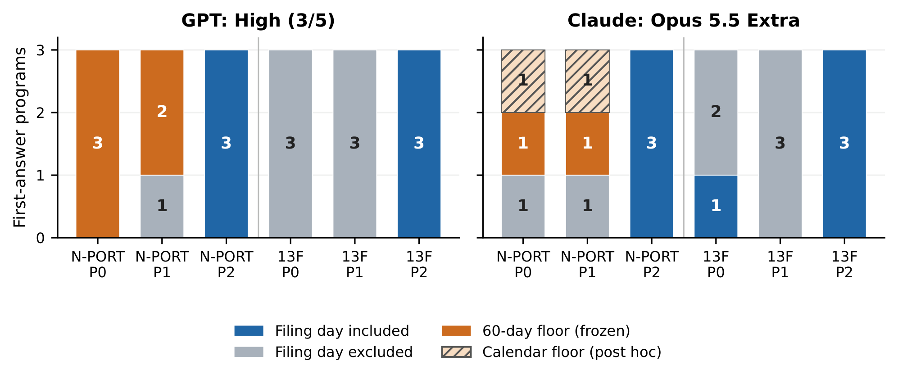

# Financial Text, Portfolio Exposure and Disclosure Timing

**Changyi Wu · Independent Researcher**

This repository includes the full research programme behind the current paper: textual fragmentation, portfolio risk, look-through accounting, aggregation diagnostics, reasoning rechecks, partial holdings and original-document tests.

**[Explore all seven research strands](research/README.md)** · **[中文研究合集](research/README.zh-CN.md)** · [Research journey](docs/research-journey.md)

Earlier work is available as browsable source code, data, mathematical derivations and raw answers, alongside the full historical manuscripts. Read original findings together with their subsequent corrections and rechecks.

---

# No Look-Ahead, Yet Too Late

**Inapplicable Disclosure Rules in LLM-Generated Backtest Code**  
Changyi Wu · Independent Researcher · Working paper, 9 November 2026

Backtest code can exclude future information and still apply the wrong historical disclosure rule. In the observed N-PORT tasks, generated programs withheld already public holdings until a 60-day floor after period end. A conventional look-ahead check did not detect that loss of usable information.

[Paper (PDF)](paper/main.pdf) · [LaTeX](paper/main.tex) · [Editable Word](paper/No_Look_Ahead_Yet_Too_Late.docx) · [中文导读](README.zh-CN.md) · [Research journey](docs/research-journey.md) · [Reproduce](docs/reproduction.md)

## What was observed

| Evidence stream | Observation | Interpretation |
| --- | --- | --- |
| Discovery, GPT dated P0/P1 | 10/12 programs used `max(filing_date, period_end + 60 days)` | An unnecessary floor, not 60 days added to filing |
| Frozen follow-up, N-PORT P0/P1 | GPT 5/6; Claude 2/6 matched the predefined floor | Two additional Claude programs matched calendar-adjusted variants identified post hoc |
| Matched Form 13F P0/P1 | 0/12 used a 45-day floor | The fixtures could detect one: it would change weights on 24–41 of 477 dates, depending on seed and boundary |
| Explicit filing-date contract, follow-up | 12/12 P2 programs matched the reference | Assistance resolved the sampled error; this is not spontaneous rule knowledge |
| Public SEC metadata | 300,464/349,673 accessions preceded day 60 | A hypothetical floor adds a mean 4.126 calendar days across the cohort; this is not a PnL estimate |



Counts describe first answers under the recorded product settings. Seeds diagnose a program and are not independent model generations. The discovery and follow-up samples are not pooled into a model failure rate. No numerical future-information witness was found on the dated inputs; intervention-specific refusals remain inconclusive.

## Why this is more than a late timestamp

The 60-day component matches the SEC's 2016 publication schedule, but the task-period rule made the relevant public N-PORT portions available upon filing. Other N-PORT texts also contain 60-day schedules. The evidence therefore establishes execution of an **inapplicable rule**, not which document a model remembered or why it selected it.

The practical lesson is to test both premature use and unnecessary withholding against the rule applicable to the historical period. The [practitioner checklist](docs/practitioner-checklist.md) translates this into implementation checks.

## The research process is part of the result

This repository preserves the route from portfolio-text invariance to disclosure timing. Several promising explanations did not survive stronger controls:

- A small-model pilot was confounded by an illustrative number in the prompt.
- A mathematically valid aggregation diagnostic had zero acceptance coverage in its tested setting.
- A 100-response reasoning-configuration recheck largely removed the earlier arithmetic failures.
- Hosted reasoning models solved all observed clean top-ten disclosure questions, and one product solved all eight original-PDF/text trials.
- A partial rule-question panel localized the useful lead to N-PORT.
- Executable-code tests exposed excessive delay, while a 13F comparison constrained the explanation.

These are separately documented stages, not a single retrospectively designed experiment. The [research journey](docs/research-journey.md), [decision log](docs/decision-log.md), and [claim ledger](docs/claim-ledger.md) explain what each stage established, what changed, and what remains unresolved. The [Chinese research narrative](docs/research-journey.zh-CN.md) provides a more conversational account.

## Start here

| Reader | Recommended route |
| --- | --- |
| Researcher reviewing the contribution | Paper → claim ledger → study-specific evidence |
| Engineer evaluating a disclosure pipeline | Practitioner checklist → reproduction guide → saved-output audits |
| Reader interested in research judgment | Research journey → decision log → historical reports |
| Reader exploring a next project | [Open questions](docs/open-questions.md), explicitly separated from completed work |

The [artifact index](docs/artifact-index.md) maps reports and evidence packages to their stages. Historical manuscripts remain intact and should be read alongside the later correction/recheck that qualifies them.

## Verification

```bash
python3 tools/check_release.py
python3 tools/reproduce_current.py --output /tmp/disclosure-timing-verification
```

The first command verifies the distributed file hashes and documented counts. The second extracts the current evidence package and runs the existing manuscript checks on saved evidence and authored reference policies. Neither command makes model requests or executes model-generated candidate programs. See [reproduction](docs/reproduction.md) for dependencies, deeper checks, and limits.

## Status and attribution

This is an independent working paper and research archive, not an accepted or peer-reviewed publication. The current manuscript is 9 PDF pages; the editable single-column Word conversion is 10 pages in the checked rendering. No new model runs were performed to prepare this repository.

Research design, implementation, collection, analysis, source checks, and writing used AI assistance. No blinded independent human replication is claimed. Public SEC metadata, controlled synthetic cases, and issuer-derived transcriptions are identified separately. [Provenance and scope](docs/provenance.md) explains the archive conventions and public export.

Contact: changyiwu04@gmail.com · hs26971@bristol.ac.uk  
The email domains do not imply institutional affiliation or endorsement. Citation metadata is provided in [CITATION.cff](CITATION.cff).
