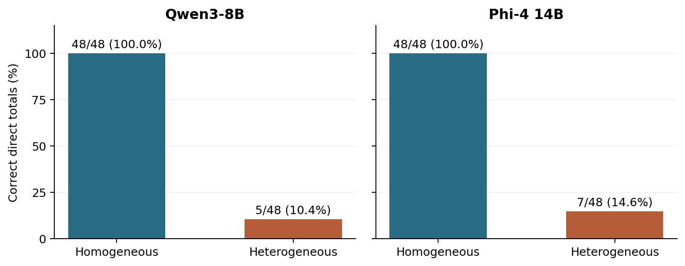

# Look-through exposure from financial text

**中文：投资组合暴露与持仓穿透。** 从“账户投入多少—母基金持有什么—目标资产占多少”逐层计算，把金额、比例、产品归属和最终合计分开核对。真实基金表格和构造账户均已保留。

## Research question

Can a model assign each disclosed holding to the correct funded lot and compute total account exposure? For funded amount Aⱼ and within-product target percentage bⱼ (in percentage units), the account percentage is

$$E=\frac{\sum_j A_j b_j}{\sum_j A_j}.$$

This is ordinary weighted accounting. In a deeper acyclic fund structure, exposure to an endpoint is a sum of products of edge weights over all funded paths. The completed studies here primarily tested **one parent-to-underlying layer**; they did not validate an arbitrary recursive or cyclic holdings engine. Shared exposures must be summed across funded paths, while duplicate records for the same position must be identified separately.

## Study and results

The archived v7 study contains **536 responses**: 216 controlled requests plus 52 published-table requests per configuration, for Qwen3-8B and Phi-4 14B. The 13 constructed source accounts reuse eight funds. Published table values are source-derived; account allocations are constructed, not customer holdings.

| Original configuration | Qwen3-8B | Phi-4 14B |
| --- | --- | --- |
| Homogeneous direct totals | 48/48 | 48/48 |
| Heterogeneous direct totals | 5/48 | 7/48 |
| Controlled exact ledgers after format-only handling | 96/96 | 96/96 |
| Published-table direct totals | 2/26 | 5/26 |
| Source ledger calculator after format-only handling | 23/26 | 26/26 |

Phi used `lots` where `rows` was requested in every ledger answer. Its strict pipeline score was zero; the secondary alias analysis changed only that key, not any number. It is an interface effect. In each model, 41/96 controlled ledgers had correct fields but an incorrect reported total after format handling.

**Read the [100-response reasoning recheck](../reasoning-recheck/README.md) alongside these numbers:** most earlier total errors disappeared under a changed configuration. These original scores are not a current-model leaderboard.

## A source error that a calculator cannot fix

For the constructed VG20/VG60 account, £3,100 has zero target exposure and £6,900 has 14.8%, giving **10.212%**. In a fragmented Qwen response, the model assigned 14.8% to all three funded lots, producing 14.8% even after a calculator. The [complete source-field failure census](source_field_failures.json) contains all three such failures, not only this example.



## Browse the actual materials

- [Controlled cases](controlled_cases.jsonl), [216 controlled prompts](controlled_prompts.jsonl), [Qwen raw responses](controlled_qwen8_raw.jsonl), [Phi raw responses](controlled_phi4_raw.jsonl).
- [13 source accounts](source_cases.jsonl), [52 source prompts](source_prompts.jsonl), [fund tables](fund_tables.json), [source provenance](source_manifest.json), [Qwen source responses](source_qwen8_raw.jsonl), [Phi source responses](source_phi4_raw.jsonl).
- [Summary](reader_summary.json), [format sensitivity](format_sensitivity.json), [original scorer](original_score.py), [format-specific parser](original_simple_parser.py), [case generator](original_build.py).
- [v9 complete manuscript](../../archive/reports/Portfolio_Exposure_v9_Full.pdf) and [source archive with v7 nested inside](../../archive/packages/Portfolio_Exposure_v9_LaTeX_and_Evidence.zip).

## Files, provenance and reproduction

The files beside this README are byte-for-byte browsing copies of the previously published archives. Some original scripts depend on their original directory layout: use the complete package for execution, or run the repository-level historical reproduction command below. Filenames were shortened for navigation; their original paths and hashes are in [the source map](../source-map.json). The complete archives preserve additional prompts, raw outputs, protocols, manuscripts and supporting files.

```bash
python3 tools/reproduce_historical.py
```

Run that command from the repository root with NumPy and SciPy installed. It checks archived evidence and reference arithmetic, without making model requests. This navigation and commentary were added retrospectively on 9 November 2026; they are not new experiments or a new preregistration. These topics overlap and must not be counted as independent studies or accepted publications.
